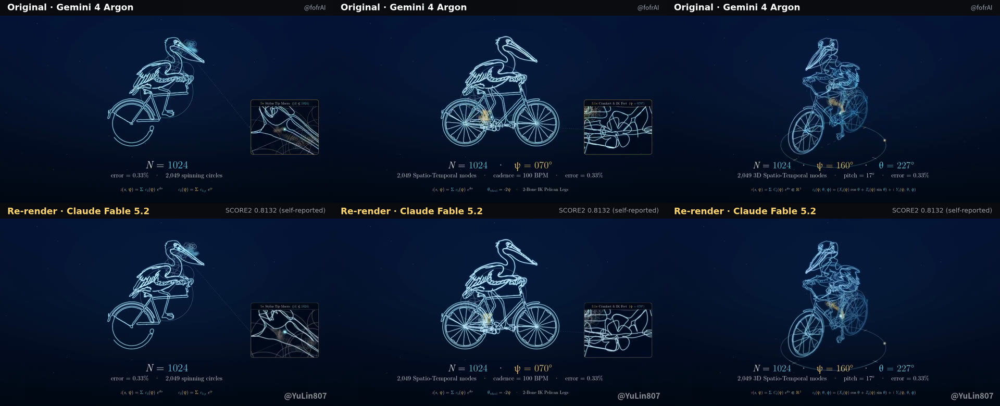
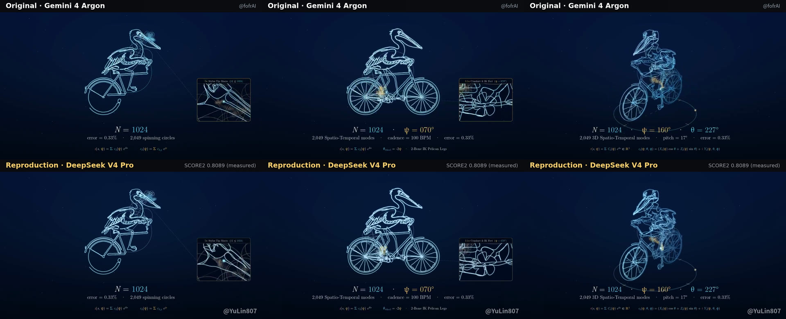
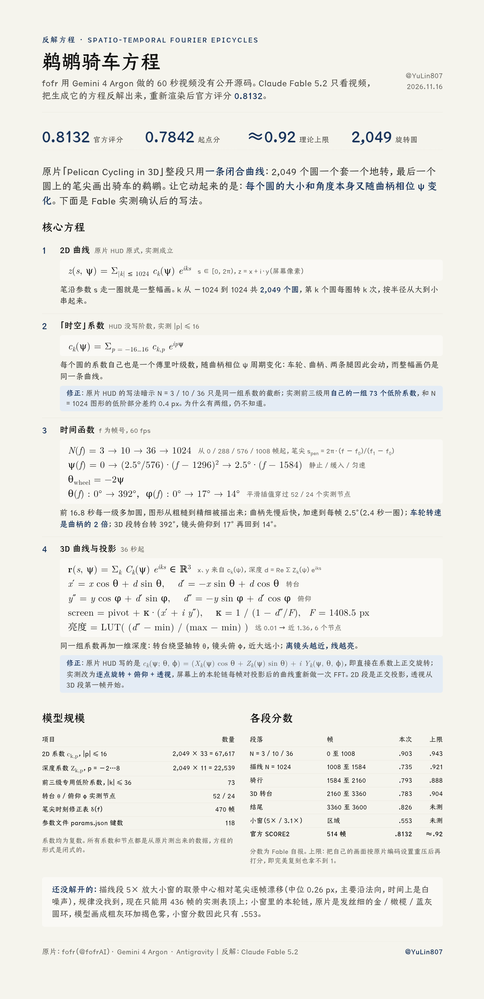

# Pelican Cycling in 3D: reverse-engineering the epicycle equations

English | [中文](README.zh-CN.md)

> **Original work: "Pelican Cycling in 3D — Spatio-Temporal Fourier Epicycles (N = 1024)" by fofr ([@fofrAI](https://x.com/fofrAI)), made with Gemini 4 Argon in Google Antigravity.**
> Original post: <https://x.com/fofrAI/status/2110045963951956250> · Google's repost: <https://x.com/Google/status/2110440182390432091>
> The video and all of its visual content belong to its author. This repository is a mathematical homage: our attempt to read the equations back out of a beautiful piece of work.



Original (top) vs. Claude Fable 5.2's re-render from the solved equations (bottom), at the tracing, riding and 3D stages.

▶ [8-second preview of our re-render](media/preview.mp4) (3D turntable segment, our render only).

## The story

In October 2026 fofr posted a 60-second video: a pelican riding a bicycle, drawn by one continuous line at the end of a chain of 2,049 spinning circles (a Fourier epicycle drawing), then pedalling, then turning in 3D. The source was not published.

We gave **Claude Fable 5.2** only the video and asked it to work out the generator: which equations, which time functions, which projection. It treated the job as an inverse problem, measured everything from the frames, and wrote the result up as [EQUATIONS.md](EQUATIONS.md).

To check that the write-up really contains the method (and not just a pile of code), we handed the document and the fitted parameters, **without the solver's code**, to **DeepSeek V4 Pro**. It wrote a new renderer from scratch ([`src/render.py`](src/render.py)) and rendered the whole film. Its version scores almost the same as the solver's own.

Full side-by-side comparison videos (original on top, re-render below): see the X post <!-- TWEET_URL -->.

## Results

Metric: SCORE2, a full-resolution weighted-Jaccard comparison with the original over 514 frames (1.0 = pixel-identical; about 0.92 is the practical ceiling because of the original's lossy encoding). Details in [BENCHMARK.md](BENCHMARK.md).

| Render | SCORE2 | Note |
|---|---|---|
| Claude Fable 5.2, starting point (previous round) | 0.7842 | self-reported |
| **Claude Fable 5.2, final equations, own renderer** | **0.8132** | self-reported (0.8102 with the same encoding as DeepSeek) |
| **DeepSeek V4 Pro, rebuilt from EQUATIONS.md + parameter files, no solver code** | **0.8089** | measured by us with `score2.py` |
| Perfect model (practical ceiling) | ≈ 0.92 | |

The reproduction lands 0.0043 below the solver's own render (0.0013 with identical encoding), so the document is complete enough for an independent model to reproduce the result.

This is a close reconstruction, not a claim that these are fofr's exact equations. The main open questions: the sub-pixel wander of the 5× inset window, which is reproduced with a measured per-frame table, and why the first three stages use their own low-order coefficients (see [EQUATIONS.md §10.6–10.7](EQUATIONS.md)).

Original (top) vs. DeepSeek V4 Pro's reproduction (bottom):



## The equations at a glance

The whole film is one closed curve whose Fourier coefficients themselves vary with the crank phase ψ:

```
z(s, ψ)  = Σ_{|k| ≤ N} c_k(ψ) e^{iks},        s ∈ [0, 2π)         2,049 circles at N = 1024
c_k(ψ)   = Σ_{p = −16..16} C[k,p] e^{ipψ}                         "spatio-temporal" coefficients
dep(s,ψ) = Re Σ_k Z_k(ψ) e^{iks}                                   depth, for the 3D segment
```

- **Time:** N steps through 3, 10, 36 and 1024 while the pen traces the figure (0–26.4 s); ψ eases in and then turns at 2.5° per frame (one pedal stroke per 2.4 s); in the 3D segment the figure turns about 392° on a turntable, θ(f), and the view pitches up to about 17°.
- **Projection:** rotation by θ about a vertical axis, pitch φ, then perspective with a focal length of about 1408.5 px; brightness follows depth.
- **Epicycles:** circles sorted by radius, centred at the partial sums of the series; in 3D the chain is rebuilt each frame from the FFT of the projected curve.



The full specification (rasterisation, glow layers, inset window, HUD compositing, and how every quantity was measured) is in [EQUATIONS.md](EQUATIONS.md).

## Why the coefficients are not included

The fitted coefficients (about 2,049 × 33 complex numbers for the curve, plus depth) and the per-frame measured tables are, in effect, fofr's artwork in numeric form. Out of respect for the original author we publish the equations, the methods and the dimensions of every quantity, but not the numbers themselves. If you have a research need for them, please get in touch ([@YuLin807](https://x.com/YuLin807)).

## Repository contents

| Path | What |
|---|---|
| [EQUATIONS.md](EQUATIONS.md) | Full generator specification as solved by Claude Fable 5.2 (English) |
| [BENCHMARK.md](BENCHMARK.md) | Benchmark protocol, SCORE2 metric, results, the reproducer's list of ambiguities |
| [`src/render.py`](src/render.py) | DeepSeek V4 Pro's renderer, written from EQUATIONS.md + parameter files, no solver code. Needs the (unpublished) parameter files and stops with an explanation without them |
| [`src/score2.py`](src/score2.py) | SCORE2 metric. Needs the original video, which you supply with `--src` |
| [`results/`](results/) | Score files (overall, per segment, per region, per frame) |
| [`media/`](media/) | Preview clip, comparison stills, equation overview |

```
pip install -r src/requirements.txt          # numpy, scipy; ffmpeg must be on PATH
python3 src/render.py --params path/to/params.json --frames 1900 1901 --out f1900.png
python3 src/score2.py --src original.mp4 --video render.mp4 --tag mine
```

## Benchmark

We plan to rerun this with each new model generation: the new model solves the equations from the video, then DeepSeek V4 Pro redraws from its document, and both scores go into [BENCHMARK.md](BENCHMARK.md).

## Credits and license

- Original video, concept and visuals: fofr ([@fofrAI](https://x.com/fofrAI)), made with Gemini 4 Argon. Copyright remains with the original author; nothing here grants rights to it.
- Equations solved by Claude Fable 5.2; reproduction by DeepSeek V4 Pro.
- Repository by [@YuLin807](https://x.com/YuLin807) on X ([ythx-101](https://github.com/ythx-101) on GitHub).
- Documentation and images we made (README, EQUATIONS.md, BENCHMARK.md, `media/equations_kami.png`, our re-render frames): [CC BY 4.0](LICENSE-docs). Code in `src/`: [MIT](LICENSE). The top halves of the comparison stills show the original video and are included only for comparison; they are not covered by our licenses.
