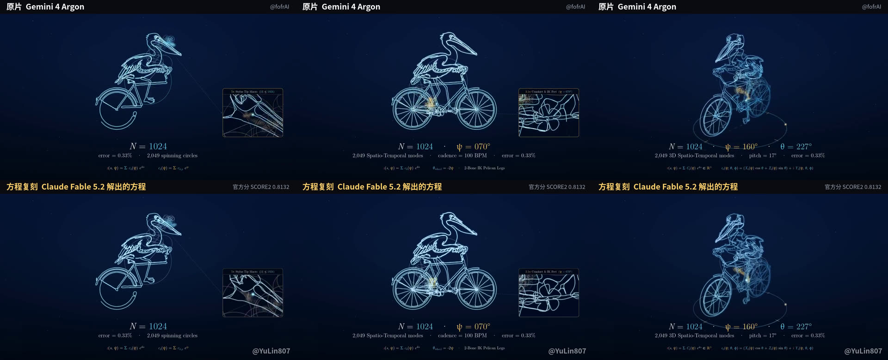
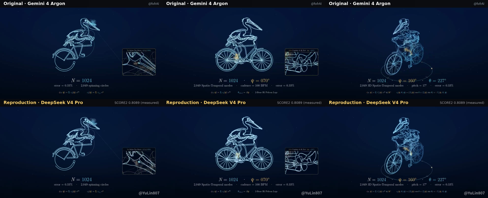
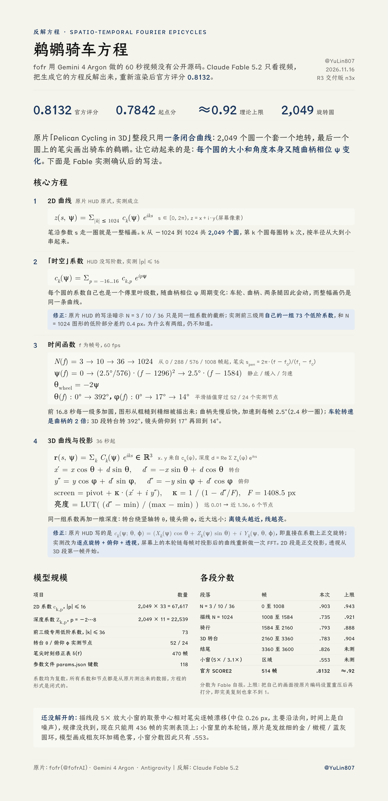

# 鹈鹕骑车 3D：反解本轮方程

[English](README.md) | 中文

> **原作："Pelican Cycling in 3D — Spatio-Temporal Fourier Epicycles (N = 1024)"，作者 fofr（[@fofrAI](https://x.com/fofrAI)），使用 Google Antigravity 中的 Gemini 4 Argon 制作。**
> 原帖：<https://x.com/fofrAI/status/2110045963951956250> · Google 转发：<https://x.com/Google/status/2110440182390432091>
> 视频及其全部视觉内容归原作者所有。本仓库只是一份数学上的致敬：我们尝试把这件漂亮作品背后的方程读出来。



原片（上）与 Claude Fable 5.2 按解出的方程重新渲染（下），分别取自描线、骑行和 3D 三个阶段。图中横幅为英文，SCORE2 分数 Fable 为自报、DeepSeek 为实测。

▶ [我们复刻版本的 8 秒预览](media/preview.mp4)（3D 转台片段，只有我们的渲染画面）。

## 缘起

2026 年 10 月，fofr 发布了一段 60 秒的视频：一只骑自行车的鹈鹕，由一条连续的线画出，线的端点连在一串共 2,049 个旋转圆环的末端（傅里叶本轮绘图）；随后鹈鹕开始蹬车，再转入 3D 视角。源码没有公开。

我们只把视频交给 **Claude Fable 5.2**，请它反推生成器：用了哪些方程、哪些时间函数、什么投影。它把这件事当作一个反问题，从画面帧中测量出所有量，并把结果整理成 [EQUATIONS.md](EQUATIONS.md)。

为了检验这份文档确实包含了完整的方法（而不只是一堆代码），我们把文档和拟合得到的参数交给了 **DeepSeek V4 Pro**，**不提供求解器的代码**。它从零写出了新的渲染器（[`src/render.py`](src/render.py)），并渲染了整部影片。它的版本得分与求解器自己的几乎相同。

完整的并排对比视频（上为原片，下为复刻）见这条 X 帖子 <!-- TWEET_URL -->。

## 结果

指标：SCORE2，即在 514 帧上与原片做全分辨率的加权 Jaccard 比较（1.0 表示逐像素一致；由于原片经过有损编码，实际上限约为 0.92）。详情见 [BENCHMARK.md](BENCHMARK.md)。

| 渲染 | SCORE2 | 备注 |
|---|---|---|
| Claude Fable 5.2，起点（上一轮） | 0.7842 | 自报 |
| **Claude Fable 5.2，最终方程，自己的渲染器** | **0.8132** | 自报（采用与 DeepSeek 相同的编码时为 0.8102） |
| **DeepSeek V4 Pro，凭 EQUATIONS.md + 参数文件重建，未看求解器代码** | **0.8089** | 我们用 `score2.py` 实测 |
| 完美模型（实际上限） | ≈ 0.92 | |

复现版本比求解器自己的渲染低 0.0043（编码相同时低 0.0013），所以这份文档足够完整，足以让一个独立的模型复现出结果。

这是一次相当接近的重建，但我们并不声称它就是 fofr 的原始方程。主要的未解问题：5 倍放大插入窗口的亚像素漂移（我们用逐帧实测表来复现它），以及为什么前三级（N = 3 / 10 / 36）用的是自己的一组低阶系数，而不是 N = 1024 图形的低阶部分（见 [EQUATIONS.md §10.6–10.7](EQUATIONS.md)）。

原片（上）与 DeepSeek V4 Pro 的复现（下）：



## 方程一览

整部影片是一条闭合曲线，其傅里叶系数本身随曲柄相位 ψ 变化：

```
z(s, ψ)  = Σ_{|k| ≤ N} c_k(ψ) e^{iks},        s ∈ [0, 2π)         2,049 circles at N = 1024
c_k(ψ)   = Σ_{p = −16..16} C[k,p] e^{ipψ}                         "spatio-temporal" coefficients
dep(s,ψ) = Re Σ_k Z_k(ψ) e^{iks}                                   depth, for the 3D segment
```

- **时间：** 画笔描出图形的过程中（0–26.4 秒），N 依次取 3 → 10 → 36 → 1024；ψ 先缓入，随后以每帧 2.5° 匀速转动（每 2.4 秒蹬一圈踏板）；在 3D 片段中图形在转台上转过约 392°（θ(f)），视角俯仰到约 17°。
- **投影：** 先绕竖直轴旋转 θ，再做俯仰 φ，然后做透视投影，焦距约 1408.5 px；亮度随深度变化。
- **本轮：** 圆环按半径排序，圆心位于级数的各个部分和处；在 3D 中，每一帧都由投影后曲线的 FFT 重建这条圆环链。



完整的规格说明（光栅化、辉光层、插入窗口、HUD 合成，以及每个量是如何测量的）见 [EQUATIONS.md](EQUATIONS.md)。

## 拟合数据

拟合出的参数、系数（曲线部分约 2,049 × 33 个复数，外加深度）和字形图集都放在 [`data/`](data/)，`src/render.py` 下载即可运行。这些是我们从视频里解出来的一个解，不是 fofr 的源码；但渲染出来的仍是 fofr 设计的那只鹈鹕，画的版权归 fofr。请用于学习和研究，展示渲染结果时注明 fofr（[@fofrAI](https://x.com/fofrAI)），不要把这幅画当成自己的作品。

## 仓库内容

| 路径 | 内容 |
|---|---|
| [EQUATIONS.md](EQUATIONS.md) | 由 Claude Fable 5.2 解出的完整生成器规格（英文） |
| [BENCHMARK.md](BENCHMARK.md) | 评测协议、SCORE2 指标、结果，以及复现者列出的含糊之处 |
| [`src/render.py`](src/render.py) | DeepSeek V4 Pro 凭 EQUATIONS.md 和参数文件写出的渲染器（未看求解器代码）。配合 `data/` 里的拟合数据直接运行 |
| [`data/`](data/) | 拟合参数（`params.json`）、系数（`coeffs_r3.npz`）和字形图集（`atlas.npz`） |
| [`src/score2.py`](src/score2.py) | SCORE2 指标。需要原片，用 `--src` 提供 |
| [`results/`](results/) | 评分文件（总体、分段、分区域、逐帧） |
| [`media/`](media/) | 预览片段、对比截图、方程总览 |

```
pip install -r src/requirements.txt          # numpy, scipy; ffmpeg must be on PATH
python3 src/render.py --params data/params.json --frames 1900 1901 --out f1900.png
python3 src/score2.py --src original.mp4 --video render.mp4 --tag mine
```

## 基准测试

我们打算在每一代新模型出来时重跑一次：新模型从视频中解出方程，再由 DeepSeek V4 Pro 依据它的文档重画，两个分数都记入 [BENCHMARK.md](BENCHMARK.md)。

## 致谢与许可

- 原视频、创意与视觉：fofr（[@fofrAI](https://x.com/fofrAI)），使用 Gemini 4 Argon 制作。版权归原作者所有；本仓库不授予任何相关权利。
- 方程由 Claude Fable 5.2 解出；复现由 DeepSeek V4 Pro 完成。
- 仓库作者：X 上的 [@YuLin807](https://x.com/YuLin807)（GitHub 上为 [ythx-101](https://github.com/ythx-101)）。
- 我们自己制作的文档和图像（README、EQUATIONS.md、BENCHMARK.md、`media/equations_kami.png`、我们复刻的帧）：[CC BY 4.0](LICENSE-docs)。`src/` 中的代码：[MIT](LICENSE)。对比截图的上半部分是原视频，仅用于对比，不在我们的许可范围内。
